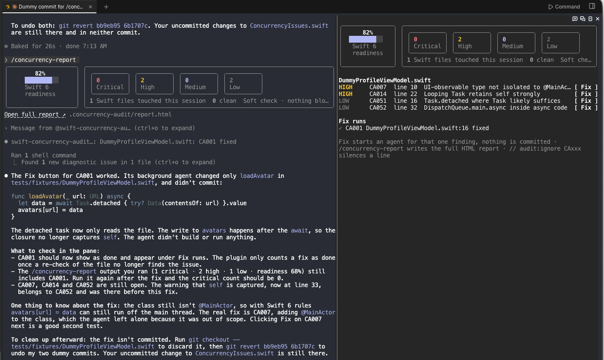
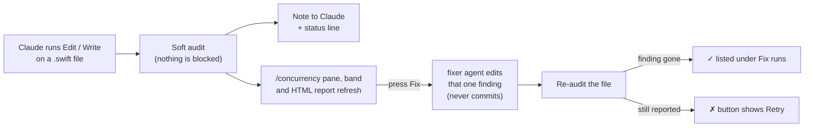

# Swift Concurrency Auditor

A Claude Code mod that soft-checks every Swift file Claude edits for concurrency bugs. Nothing is blocked: after each `Edit` or `Write` to a `.swift` file, Claude reads a short note with any findings and can fix them in the same turn, and you see a summary on the status line.



*Left: `/concurrency-report` draws the readiness card and severity tiles inline. Right: the `/concurrency` pane, with a **Fix** button per finding and finished runs under **Fix runs**.*

Try the plugin without installing it: the [interactive explainer](docs/how-it-works.html) simulates the pane and its Fix buttons, includes a readiness calculator, and lets you browse every rule. Open the file locally in a browser, or use the [hosted version](https://claude.ai/artifact/A2GQUG6HPmLJe1occEmdeg).

Requires Claude Code 2.1.287 or later.

## How it works



## Install

At the prompt of a terminal session:

```
/plugin install swift-concurrency-auditor --marketplace badrinathvm/swift-concurrency-auditor
```

From a shell:

```
claude plugin install swift-concurrency-auditor --marketplace badrinathvm/swift-concurrency-auditor
```

Answer `y` to add the marketplace, then pick a scope (user scope loads it in every session).

In the desktop app: click + next to the prompt box, then Plugins, Add marketplace with `badrinathvm/swift-concurrency-auditor`, then Add plugin.

## What it checks

| ID | Severity | Rule |
|---|---|---|
| CA001 | critical | `Task.detached` that mutates `self` (likely data race) |
| CA007 | high | `@Observable` / `ObservableObject` class not isolated to `@MainActor` |
| CA014 | high | Looping `Task` that captures `self` strongly |
| CA021 | medium | `@unchecked Sendable` or `nonisolated(unsafe)` |
| CA030 | medium | `TaskGroup` children that never check cancellation |
| CA042 | low | Blocking calls (semaphores, `Thread.sleep`, `DispatchQueue.main.sync`) in async code |
| CA051 | low | `Task.detached` where `Task` likely suffices |
| CA052 | low | `DispatchQueue.main.async` inside async code |

The checks are fast pattern matches, not the compiler, so expect some false positives. Silence one on a line with `// audit:ignore CA014`.

### Swift 6 readiness score

The pane, the band and the report all show one readiness score. It starts at 100, each open finding subtracts points by severity, and it never goes below 0 (`hooks/report.ts`):

| Severity | Points per finding |
|---|---|
| critical | −15 |
| high | −8 |
| medium | −4 |
| low | −1 |

In the screenshot above, 2 high and 2 low findings give 100 − 16 − 2 = **82%**. Fixing a finding raises the score the next time the file is audited.

To see every rule fire, run `/concurrency-audit tests/fixtures/ConcurrencyIssues.swift` and then `/concurrency-report`: the sample trips all eight rules once each, and its one `// audit:ignore` line stays silent.

## Commands

- `/concurrency` — live pane of findings for every Swift file touched this session. Each finding has a **Fix** button that starts a background agent (`swift-concurrency-auditor:fixer`, with the swift-concurrency skill preloaded) to fix that one finding. The agent can only read and edit files, so it never commits or pushes. The button reads **Fixing…** while the agent works and **Retry** if it fails. A fix counts as done only when re-auditing the file shows the finding gone. Finished runs are listed under **Fix runs**. One fix runs per file at a time; other buttons on that file show **Wait** meanwhile. Esc closes the pane; fixes already running carry on in the background.
- `/concurrency-report` — writes `.concurrency-audit/report.html`, the full HTML dashboard, and shows a visual summary in a band above the prompt: a Swift 6 readiness card beside Critical / High / Medium / Low tiles, one compact row per finding, an **Open full report ↗** link and Open pane / Dismiss buttons. The command's own output row draws the readiness card and severity tiles inline with the **Open full report ↗** link; Claude reads it as one summary line with the report's `file://` link.
- `/concurrency-audit path/File.swift` — audit any file on demand; the same band and report follow

Every Edit/Write to a Swift file that changes its findings also refreshes the report and the band, and logs one summary line with the link. Open the report from the band's link, or with `open .concurrency-audit/report.html`.

## Develop

```
claude --plugin-dir ./swift-concurrency-auditor   # load from source, hot-reloads on save
claude plugin validate ./swift-concurrency-auditor
claude plugin test ./swift-concurrency-auditor
```

Tested with Claude Code 2.1.302.
